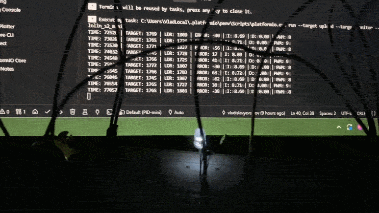

# ESP32 - Learning Project

This is a small educational project for the [Embedded Development course](https://beetroot.academy/courses/online/kurs-embedded-development)

## Circuit Diagram

```
ESP32-S2-mini

                    +----------------------+
3.3V ---------------|                      |
                    |    ESP32-S2-mini     |
GPIO4 --------------|                      |
GPIO6 --------------|                      |
                    |                      |
                    |                      |
                    |                      |
                    |                      |
GND ----------------|                      |
                    +----------------------+


Potentiometer

+-------+
|       |--- 3.3V
|   O   |--- GPIO 6
|       |--- GND
+-------+


WHITE LED

GPIO4 ───[220Ω]───|>|────────────── GND
                  LED

```

## Result



If GIF preview is not displayed in your viewer, open it directly: [result.gif](./result.gif)

